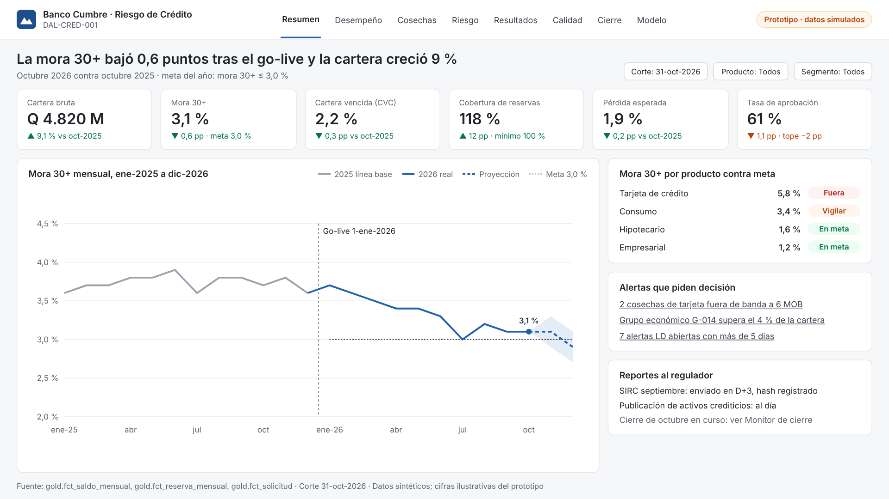

# DAL-CRED-001 · Centro de Riesgo de Crédito y Cartera

  

> Del deterioro tardío a la alerta temprana: monitoreo de cartera, clasificación y reservas conforme a JM-47-2022, y originación con scoring y controles LD/IVE para un banco ficticio guatemalteco.

## Problema y decisión

Banco Cumbre (ficticio) detecta tarde el deterioro de su cartera, arma el cierre mensual a mano en Excel y aprueba créditos con criterio variable entre analistas.

**Decisión que mejora:** el Jefe de Créditos decide a diario qué solicitudes aprobar y con qué límite, y cada mes certifica la clasificación de la cartera, sus reservas y el envío al SIRC, para crecer dentro del apetito de riesgo.

## Objetivos

| ID | Objetivo | Línea base | Meta |
| --- | --- | --- | --- |
| O1 | Tiempo de cierre mensual de cartera | 3 días | 4 horas |
| O2 | Cosechas deterioradas alertadas al menos 2 meses antes de su mora 90+ | 0 alertas automáticas | 100 % |
| O3 | Mora 30+ a 6 meses de cosechas de consumo y tarjeta | 4,8 % | 3,8 % |

## Requisitos de las vacantes que demuestra

Monitoreo de cartera, cosechas y mora · evaluación de crédito con 5 C's y scoring · políticas y reglas de crédito · normativa SIB, unidades de riesgo e IVE · reportería en Excel y Power BI · SQL y Python.

## Arquitectura

Fuentes sintéticas (Python) → Landing (hash SHA-256) → Bronze → Silver (SCD2) → **Gold certificada** → modelo semántico Power BI → tableros, reportes regulatorios y monitor de cierre. Orquestación con Airflow y corrida diaria pública con GitHub Actions; pruebas con dbt en cada capa.

## Vistas (prototipo F2)

| Vista | Pregunta |
| --- | --- |
| [01 Resumen ejecutivo](docs/img/dal-cred-001_01-resumen-ejecutivo_prototipo.png) | ¿Cómo va el área contra meta y año anterior? |
| [02 Desempeño de cartera](docs/img/dal-cred-001_02-desempeno-cartera_prototipo.png) | ¿Dónde se concentra el resultado? |
| [03 Diagnóstico de cosechas](docs/img/dal-cred-001_03-diagnostico-cosechas_prototipo.png) | ¿Por qué se movió la mora? |
| [04 Riesgo y cumplimiento](docs/img/dal-cred-001_04-riesgo-cumplimiento_prototipo.png) | ¿Estamos dentro de límites y normativa? |
| [05 Resultados del proyecto](docs/img/dal-cred-001_05-resultados-proyecto_prototipo.png) | ¿Qué cambió desde el go-live? |
| [06 Calidad de datos](docs/img/dal-cred-001_06-calidad-datos_prototipo.png) | ¿Podemos confiar en las cifras? |
| [07 Monitor de cierre](docs/img/dal-cred-001_07-monitor-cierre_prototipo.png) | ¿El cierre del mes va en tiempo? |
| [08 Modelo y políticas](docs/img/dal-cred-001_08-modelo-politicas_prototipo.png) | ¿El score funciona y qué pasa si cambio el corte? |

## Plan y fase actual

Metodología Data & Analytics Lab: 8 fases y 7 compuertas en 8 semanas (26-oct a 23-dic-2026).

- **Fase actual:** F2 Planificación y diseño
- **Próximo hito:** G3 Gold certificado (27-nov-2026)

## Supuestos

- Todos los datos son sintéticos; Banco Cumbre es ficticio y no representa a ninguna entidad real.
- Periodo: enero 2025 a diciembre 2026; corte 31-oct-2026; go-live simulado 1-ene-2026.
- Las cifras de las vistas prototipo son ilustrativas; en F4 se reemplazan por datos calculados desde Gold.
- El formato del archivo SIRC es simulado si el instructivo oficial no es público.
- Proyecto de una sola persona: la segregación de funciones se simula con ramas protegidas y revisión independiente.
